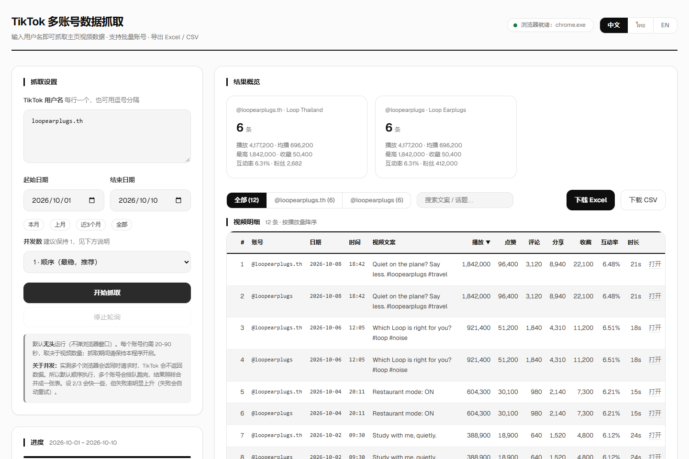

# TikTok 多账号数据抓取

**输入用户名 → 自动抓取主页全部视频数据（播放 / 点赞 / 评论 / 分享 / 收藏 / 时长 / 文案 / 话题标签）→ 导出 Excel。**

打包成桌面应用和单文件 exe，**自带浏览器，目标机器不需要装 Node.js，也不需要 Chrome**。

[](https://github.com/liyangru/tiktok-scraper/releases/latest)
[](https://github.com/liyangru/tiktok-scraper/releases/latest)
[](#许可)



---

## 下载

去 **[Releases](https://github.com/liyangru/tiktok-scraper/releases/latest)** 下载对应平台：

| 平台 | 文件 | 说明 |
|---|---|---|
| **Windows** | `TikTokScraper-*.exe` | Electron 桌面应用，**双击即用（推荐）** |
| Windows | `tiktok-scraper.exe` | pkg 单文件便携版（备选，体积更小） |
| **macOS Apple Silicon** | `TikTokScraper-*-arm64-mac.zip` | M 系列芯片 |
| macOS Intel | `TikTokScraper-*-x64-mac.zip` | Intel 芯片 |
| 本地 / 服务器 | `tiktok-scraper-server-*.tar.gz` | 源码 + `start.sh`，需 Node 18+ |

**首次运行**

- **Windows**：双击 exe。首次启动会把自带 Chromium 解压到同目录的 `tiktok-scraper-data/`（约 440MB，几秒），之后秒开。
- **macOS**：解压后把 `.app` 拖进「应用程序」。未做 Apple 公证，首次打开请**右键 → 打开**，或执行
  `xattr -dr com.apple.quarantine /Applications/TikTokScraper.app`
- **服务器**：解压后 `./start.sh`。

> 每个版本的改动记录见 **[CHANGELOG.md](CHANGELOG.md)**，Release 说明也是从那里自动抽取的。

---

## 功能

- **真实浏览器抓取**，拿的是 TikTok 官方原始 JSON，不是爬 HTML（见下方原理）
- **多账号批量**，支持换行 / 逗号 / 空格分隔，也可直接粘贴主页链接
- **日期区间筛选**（今天、本月、上月、近三个月、全部，或自定义）
- **导出 Excel / CSV**，列包含播放、点赞、评论、分享、收藏、互动率、时长、文案、话题标签
- **界面**：极简黑白灰；三语（中文 / ไทย / English）；加载骨架屏；按任意列排序；账号标签页；关键词搜索
- **桌面体验**：独立应用窗口（无命令行黑框、无浏览器外壳、无「Chrome 测试版」横幅）；单实例；关窗即退出；导出文件自动落到系统「下载」目录并打开文件夹
- **零依赖运行**：浏览器随包分发，不联网下载、不回退系统 Chrome

---

## 它是怎么工作的

不是爬 HTML，而是**驱动一个真实 Chrome 打开主页，拦截 TikTok 自己发出的 `/api/post/item_list` 响应**，直接拿官方原始 JSON。

这样做的好处：数据结构稳定、字段完整、不用跟着前端 DOM 改版走。

### ⚠️ 四个硬约束（踩过的坑，改之前先看）

| 约束 | 原因 |
|---|---|
| **必须用 Patchright 引擎** | TikTok 拦的是 Playwright 的 CDP 协议指纹。实测：playwright-core 无头被拦（返回空 body），**换成 patchright 后无头/有头都能通**。早期「必须有头」的结论是误判 —— 缺的是引擎，不是显示器。 |
| **并发必须保持 1** | 多会话同时请求时 TikTok 不返回数据（多浏览器 / 多标签页 / 多 profile 都试过）。默认 `CONCURRENCY=1`，配合无数据自动重试兜底。 |
| **不能靠「最早视频日期」判断抓完** | 置顶视频日期很老，会立刻误判结束。改用 API 返回的 `cursor` 分页游标判断。 |
| **Docker 里要 `CHROME_NO_SANDBOX=1`** | root 环境下 Chromium 不关沙箱起不来。 |

补充：无头模式（`BROWSER_HEADLESS=1`）实测**可用**，容器部署不需要 xvfb。但如果哪天突然全部返回空数据，优先怀疑被限流（约半天恢复），其次再排查指纹。

---

## 从源码运行

```bash
npm install
node server.js          # 打开 http://127.0.0.1:8899
```

- **端口冲突**：默认 `8899`，被占用会**自动往后顺延**（8900、8901…），以控制台打印的地址为准。想固定就设 `PORT`。
- **浏览器**：自动探测系统 Chrome。装在别处就设 `CHROME_PATH`。也可以 `npx playwright install chromium` 下一份随项目用。

### 打包

```bash
npm run app          # Electron 开发运行
npm run build:app    # → release/TikTokScraper-<版本>.exe（Electron 便携版）
npm run build:exe    # → dist/tiktok-scraper.exe（pkg 单文件版）
```

### macOS 版

**必须在 Mac 上构建**，两条硬约束绕不过去：

1. `electron-builder` 从 26 版起**直接拒绝**在 Windows / Linux 上出 macOS 包（报 `Build for macOS is supported only on macOS`）。
2. Apple Silicon 上，**任何未签名（或改了内容导致签名失效）的 app 都起不来**。签名只能用 macOS 自带的 `codesign`。

所以在 Mac 上一条命令：

```bash
bash scripts/build-mac.sh                 # 默认 arm64 + x64
ARCHS="arm64" bash scripts/build-mac.sh   # 只要 Apple Silicon
```

脚本会：装依赖 → 生成图标 → 下载对应架构的 Chromium 并打成载荷 → `electron-builder --mac zip --<arch>` → 补一次 **ad-hoc 签名**。

> 载荷约 180–190MB，**超出 GitHub 单文件 100MB 上限，所以不入库**。首次构建下载一次，之后复用本地那份。

**没有 Mac？** 用 GitHub Actions 出包：仓库带 `.github/workflows/build-mac.yml`，推上去后在 Actions 页手动 Run workflow，跑完从 Artifacts 下载 `TikTokScraper-mac-arm64` / `-x64`。

---

## 发布新版本

日常改动先记在 [CHANGELOG.md](CHANGELOG.md) 的 `## [Unreleased]` 区块里 —— **没打算发版就留在那里，不要为了发版而发版**。确定要发版时才：

```bash
# 1. 把 CHANGELOG.md 的 ## [Unreleased] 改名成 ## [x.y.z] - 日期，并在最上面新开一个空的 ## [Unreleased]
# 2. 同步 package.json 的 version
git add -A && git commit -m "release: v1.0.2"
git tag v1.0.2 && git push origin master --tags
```

CI 会自动：在 GitHub 的机器上构建 **Windows ×2 + macOS ×2 + 部署包** → **从 `CHANGELOG.md` 抽取 `## [1.0.2]` 段落作为 Release 说明** → 发 Release。

> tag 名要和 changelog 标题对得上（`v1.0.2` ↔ `## [1.0.2]`）；对不上会自动回退成按 commit 生成。

> 🚫 **旧版本的 Release 和 tag 默认全部保留，不要自作主张删。** 每个历史版本都要能回溯、能回滚；新版本正常发即可，GitHub 会自动把最新一版标为 Latest。只有明确要求删某个版本时才删。

一条命令建仓库 + 推送 + 打 tag（`scripts/publish-github.sh`）：

```bash
gh auth login                                                       # 需要 workflow scope
VISIBILITY=public bash scripts/publish-github.sh <owner>/<repo> v1.0.2
```

> ⚠️ 凭据必须有 **`workflow`** scope，否则 GitHub 会拒绝推送 `.github/workflows/` 下的文件。补：`gh auth refresh --hostname github.com --scopes workflow`

---

<details>
<summary><b>目录结构</b>（点击展开）</summary>

```
tiktok-scraper/
├── server.js              Express 服务 + API（导出 start() 供 Electron 嵌入）
├── bootstrap.js           pkg 单文件 exe 的入口：解压浏览器 → 启动服务
├── electron/main.js       Electron 主进程：应用窗口、单实例、关窗退出、导出下载
├── lib/
│   ├── scraper.js         抓取核心：驱动 Chromium + 拦截 item_list
│   ├── browsers.js        跨平台浏览器定位（Win / macOS / Linux 布局）
│   ├── displayApi.js      TikTok 展示 API
│   └── report.js          Excel / CSV 报表生成
├── public/                前端（无框架，原生 HTML/CSS/JS）
│   ├── index.html  style.css  app.js  i18n.js（中/泰/英）
│   └── fonts/geist-latin.woff2
├── scripts/
│   ├── build-mac.sh             Mac 一键出包
│   ├── make-mac-payload.py      zip → tar.gz（保留 .app 的符号链接与权限位）
│   ├── verify-mac-payload.py    载荷自检
│   ├── make-icon.js             SVG → ico / png
│   ├── patch-pkg.js             pkg 打包前的两处兼容补丁
│   ├── patch-exe-subsystem.js   PE 子系统 3→2（去掉命令行黑框）
│   └── publish-github.sh        建仓库 + 推送 + 打 tag
├── .github/workflows/
│   ├── release.yml        打 tag → 全平台构建 + 发 Release
│   └── build-mac.yml      手动 → 只出 macOS 包
├── Dockerfile  docker-compose.yml  tencent-setup.sh   服务器部署
└── CHANGELOG.md
```

</details>

<details>
<summary><b>单文件 exe（pkg 版）的打包细节</b>（点击展开）</summary>

用 [`@yao-pkg/pkg`](https://github.com/yao-pkg/pkg) 把 `bootstrap.js` 打成 node22 单文件；`bootstrap.js` 负责「首次解压浏览器 + 启动服务」。Chromium 以 `browser-payload.tar.gz` 形式内嵌（见 `package.json` 的 `pkg.assets`）。

**`scripts/patch-pkg.js`**（`build:exe` 会自动先跑）修两个 pkg 兼容坑：

1. pkg 的 node 剥离了 `inspector` 绑定，而 playwright 初始化 page 模块时会 `require("inspector")` → 换成无害 stub（仅用于 `page.pause()` 调试，本工具用不到）。
2. `generator-function` / `async-function` 的 `exports` 指向 `.mjs`，pkg 的 ESM 加载器读不了虚拟快照 → 改成走它们的 CJS 入口。

**`scripts/patch-exe-subsystem.js`** 把 PE 可选头的 `Subsystem` 从 3（console）改成 2（GUI），双击不再弹黑框；日志改写到 `tiktok-scraper-data/app.log`。

打包必须带 **`--no-bytecode`**：否则 pkg 把 JS 编译成 V8 字节码，`Function.prototype.toString()` 失真，playwright 注入函数时会报 `Passed function is not well-serializable!`（`addInitScript` / `evaluate` 全废）。

> ⚠️ 补丁会改动 `node_modules`，所以**每次 `npm install` 之后都要重新 `npm run build:exe`**（脚本已内置 patch 步骤）。

</details>

<details>
<summary><b>部署到服务器（Docker）</b>（点击展开）</summary>

### ⚠️ 第一件事：必须选海外节点

**中国内地节点无法访问 TikTok，部署完就是摆设。** 买机器时地域必须选中国香港 / 新加坡 / 曼谷 / 硅谷；北京 / 上海 / 广州 / 成都都不行。

轻量应用服务器（Lighthouse）或 CVM 都行，配置建议 **2 核 2G 起步**（Chromium 吃内存）。

```bash
# ① 本地打包
bash pack.sh                                  # 生成 tiktok-scraper.tar.gz

# ② 上传
scp tiktok-scraper.tar.gz root@<服务器IP>:/root/

# ③ 服务器上一键装好并启动
mkdir -p /root/tiktok-scraper && tar -xzf /root/tiktok-scraper.tar.gz -C /root/tiktok-scraper
cd /root/tiktok-scraper && bash tencent-setup.sh
```

脚本会自动：装 Docker → 生成访问口令 → 构建镜像 → 启动 → 打印带口令的访问地址。

**④ 放行端口**：去腾讯云控制台 → 防火墙 / 安全组，放行 TCP `8899`。不做这步外网访问不了。

也可以直接 `python deploy_remote.py <IP> <用户> <密码>` 走 SSH 一键部署。

**资源估算**：每个 Chrome 进程约 300–400MB 内存；2GB 内存跑得动（并发 1）；单账号 20–90 秒。

**安全**：已内置访问口令（`ACCESS_TOKEN`，`tencent-setup.sh` 自动生成随机值）。首次访问用 `http://<IP>:8899/?token=<口令>`，之后种 cookie。有域名建议再套一层 Caddy 自动 HTTPS。

</details>

<details>
<summary><b>环境变量 / API</b>（点击展开）</summary>

### 环境变量

| 变量 | 默认 | 说明 |
|---|---|---|
| `PORT` | `8899` | 监听端口。**被占用会自动往后顺延**，以控制台打印为准 |
| `HOST` | `127.0.0.1` | 监听地址，Docker 里设 `0.0.0.0` |
| `ACCESS_TOKEN` | 空 | 访问口令。**留空 = 不鉴权，只适合本机用**；公网必须设 |
| `CONCURRENCY` | `1` | 并发数。**实测 >1 不可靠**，建议保持 1 |
| `MAX_SCROLLS` | `400` | 单账号最大滚动次数，防死循环 |
| `CHROME_PATH` | 自动探测 | Chrome / Chromium 可执行文件路径 |
| `CHROME_NO_SANDBOX` | `0` | Docker / root 环境必须设 `1` |
| `BROWSER_HEADLESS` | 发行版 `1` / 源码 `0` | 无头开关。发行版默认无头（静默后台抓） |
| `SCRAPER_DEBUG` | `0` | 设 `1` 输出页面诊断日志 |

### API

| 方法 | 路径 | 说明 |
|---|---|---|
| `GET` | `/api/health` | 健康检查，返回检测到的浏览器路径 |
| `POST` | `/api/scrape` | 提交任务 `{handles, from, to, concurrency}` |
| `GET` | `/api/jobs/:id` | 查询进度与结果 |
| `GET` | `/api/jobs/:id/export.xlsx` | 下载 Excel |
| `GET` | `/api/jobs/:id/export.csv` | 下载 CSV |
| `GET` | `/api/jobs` | 历史任务列表 |
| `DELETE` | `/api/jobs/:id` | 删除任务 |

</details>

---

## 已知限制

- **抓不到私密 / 已删除视频**，只能拿公开数据
- **评论区数据拿不到**，只有评论数
- **播放量是 TikTok 的公开口径**，非后台真实数据，会有偏差
- **频繁抓取可能触发风控**（表现是全部返回空数据，约半天恢复），建议并发不超过 3，账号多时分批
- 任务状态存在内存 + `data/jobs/*.json`，服务重启后历史任务仍可查看，但**运行中的任务会丢失**

## 许可

MIT
